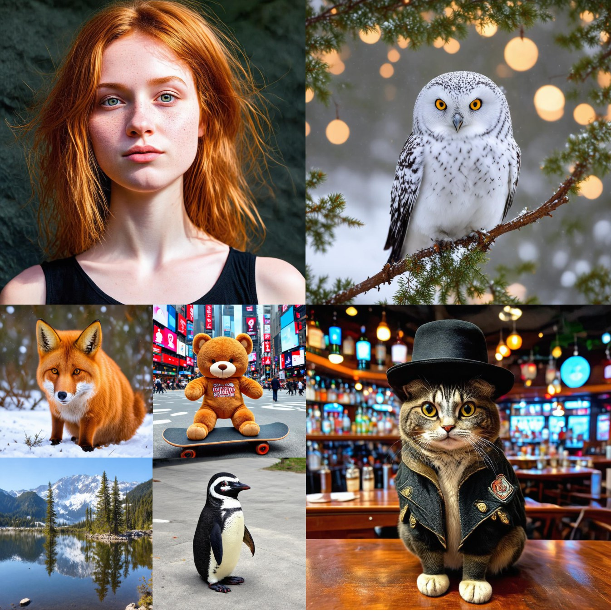
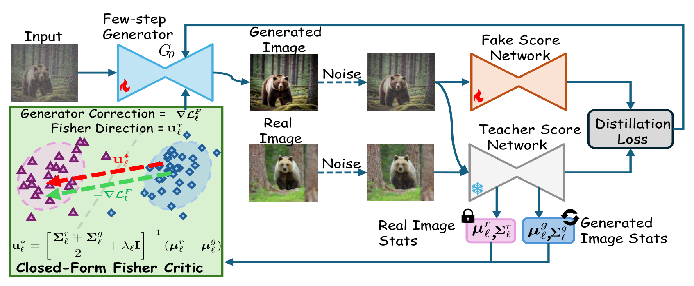

# FisherDistill: Diffusion Distribution Distillation via Closed-Form Fisher Critics

**Mahesh Bhosale**1, **Yuanhao Zhai**2, **Siwei Lyu**1, **Junsong Yuan**1, **David Doermann**1, **Defang Chen**3†

1University at Buffalo, SUNY &nbsp;·&nbsp; 2Meta &nbsp;·&nbsp; 3University of California, Berkeley

†Corresponding author.

[**Project page**](https://bhosalems.github.io/FisherDistill/) &nbsp;·&nbsp; arXiv (coming soon) &nbsp;·&nbsp; Code (coming soon)

1024×1024 samples from our 2-step FisherDistill built on 1.x-Distill Stage-I and distilled from SD3-Medium.

## Abstract

Recent advances in diffusion distillation have enabled high-quality image generation in only one or a few network function evaluations (NFEs). Despite their efficiency, aggressively distilled generators often retain a residual distribution gap from their multi-step teachers, motivating recent methods to introduce adversarial refinement with a learned discriminator. In this work, we ask whether such refinement necessarily requires a learned adversarial discriminator. We introduce FisherDistill, a simple alternative based on Fisher linear discriminant analysis. Using intermediate representations from the frozen teacher, we estimate the first- and second-order statistics of real and generated samples and derive a closed-form Fisher direction that maximally separates their feature distributions relative to within-class variation. This direction provides a lightweight refinement signal that complements the original distillation objective without requiring an additional adversarial discriminator or its optimization loop. Across multiple distillation frameworks, our approach consistently improves generation quality over their respective distilled baselines and substantially closes the gap to adversarially refined counterparts.

## Method

FisherDistill augments an existing distillation framework without modifying its base objective. For each selected layer ℓ of the frozen teacher, features of real and generated images are taken at a fixed noise level tF. Real statistics are precomputed once; generated statistics are tracked online with an EMA. The closed-form Fisher direction

u\*ℓ = [ ½(Σrℓ + Σgℓ) + λℓI ]−1 (μrℓ − μgℓ)

defines a signed margin rℓ(f) and a closed-form critic DFℓ(f) = σ(rℓ(f)). The generator is trained with the non-saturating loss −log DFℓ averaged over the selected layers, added to the base distillation loss. Gradients flow through the frozen teacher into the generator only. There is no learned discriminator and no adversarial min-max loop. The critic is one step lagged, so it never scores the features it was estimated from.

## Results

### Class-conditional ImageNet 64×64 (EDM teacher, NFE = 1)

| Method | FID ↓ | Prec. ↑ | Rec. ↑ |
|---|---:|---:|---:|
| DMD | 2.64 | 0.76 | 0.59 |
| DMD2† (GAN) | 1.42 | 0.74 | 0.60 |
| RealUID† (on DMD) | 3.07 | 0.74 | 0.58 |
| **FisherDistill (on DMD)** | **1.40** | 0.74 | 0.62 |
| SiD (α = 1.2) | 1.54 | 0.74 | 0.63 |
| SiD²A† (GAN, α = 1.0) | 1.31 | 0.74 | 0.62 |
| RealUID† (on SiD) | 1.45 | 0.74 | 0.62 |
| **FisherDistill (on SiD)** | **1.34** | 0.76 | 0.63 |

### Text-to-image, zero-shot COCO-2014

| Teacher · framework | Method | NFE | FID ↓ | CLIP ↑ | GenEval ↑ | HPSv2 ↑ | PickScore ↑ |
|---|---|---:|---:|---:|---:|---:|---:|
| SD v1.5 · DMD2 | DMD2† (GAN) | 1 | 8.58 | 0.300 | 0.343 | 0.256 | 20.00 |
| | RealUID† | 1 | 9.37 | 0.303 | 0.352 | 0.256 | 20.06 |
| | **FisherDistill** | 1 | **8.46** | 0.304 | 0.348 | 0.257 | 20.07 |
| SD3-Medium · 1.x-Distill | Stage II† (GAN) | 2 | 30.20 | 0.330 | 0.655 | 0.288 | 22.59 |
| | RealUID† | 2 | 34.03 | 0.326 | 0.641 | 0.279 | 21.99 |
| | **FisherDistill** | 2 | **29.54** | 0.330 | 0.682 | 0.294 | 22.37 |
| SANA 0.6B · SiD-DiT | SiD²A-DiT† (GAN) | 1 | 34.13 | 0.298 | 0.486 | 0.244 | 21.00 |
| | RealUID† | 1 | 31.87 | 0.320 | 0.590 | 0.274 | 21.46 |
| | **FisherDistill** | 1 | **25.24** | 0.326 | 0.597 | 0.286 | 21.80 |
| SANA 1.6B · SiD-DiT | SiD²A-DiT† (GAN) | 1 | 28.58 | 0.323 | 0.615 | 0.289 | 21.81 |
| | RealUID† | 1 | 34.28 | 0.322 | 0.578 | 0.279 | 21.60 |
| | **FisherDistill** | 1 | **26.73** | 0.326 | 0.603 | 0.289 | 21.73 |

† Reproduced with the official code under a matched training budget. Each group is evaluated with its base framework's protocol; compare within a group only. Full tables (including teachers, Aesthetic and ImageReward scores) are in the paper and on the [project page](https://bhosalems.github.io/FisherDistill/).

- The one-step FisherDistill SANA models match or surpass their 20-step teachers in FID (25.24 vs. 26.38 at 0.6B; 26.73 vs. 26.83 at 1.6B).
- FisherDistill reaches its best FID after **1.34M** refinement samples on DMD2, versus **4.93M** for the matched GAN arm (∼1.0M vs. ∼2.0M on SiD-DiT).

## Code

Source code will be released in this repository.

## Citation

BibTeX will be added with the arXiv release.
